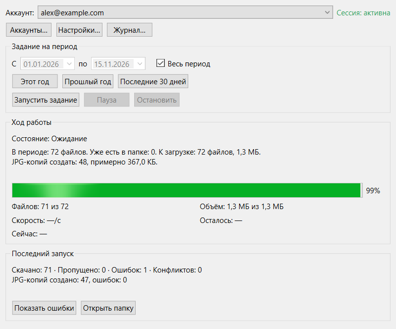

# iCloud Photo Downloader для Windows

**Версия для macOS:** SwiftUI-приложение для Apple Silicon с русским и английским интерфейсом. Инструкции по сборке, ограничения и проверка — в [docs/MACOS.md](docs/MACOS.md).

Скачивает фото и видео из iCloud Photos за выбранный период и раскладывает их по папкам `ГГГГ\ММ Month\Full size` (оригиналы) и `Compact` (JPG-копии). В iCloud ничего не меняет.

*A Windows desktop app that downloads photos and videos from iCloud Photos for a chosen period into `YYYY\MM Month\Full size` (originals) and `Compact` (JPG copies). It is read-only: nothing in iCloud is ever changed or deleted. The interface is in Russian. English 🇬🇧, Spanish 🇪🇸 and Chinese 🇨🇳 locales are planned to be added soon.*



Состояние: MVP (ядро, окна и трей, сборка с установщиком). Программа проверена на одном реальном аккаунте iCloud; что проверено и что нет, перечислено в конце [docs/ARCHITECTURE.md](docs/ARCHITECTURE.md).

Проект не связан с Apple. Он работает через неофициальный веб-доступ к iCloud (библиотека [`icloudpd`](https://github.com/icloud-photos-downloader/icloud_photos_downloader)) и может перестать работать, если Apple изменит свой сервис. Пароль хранится только в диспетчере учётных данных Windows и никуда, кроме серверов Apple, не отправляется.

| Документ | О чём |
| --- | --- |
| [REQUIREMENTS.md](REQUIREMENTS.md) | техническое задание |
| [docs/ARCHITECTURE.md](docs/ARCHITECTURE.md) | как устроена и как работает программа |
| [docs/CRITICAL_DECISIONS.md](docs/CRITICAL_DECISIONS.md) | решения, которые влияют на поведение или отступают от ТЗ |
| [docs/DECISIONS.md](docs/DECISIONS.md) | технические решения и выводы по библиотеке iCloud |
| [docs/MANUAL_TEST.md](docs/MANUAL_TEST.md) | чек-лист проверки на реальном аккаунте |

## Установка

Готовый установщик, если он опубликован, лежит на странице Releases репозитория. Иначе соберите его сами (раздел «Сборка установщика»).

Запустите `iCloudPhotoDownloader-Setup-<версия>.exe`. Права администратора не нужны, программа ставится в профиль пользователя.

Программа не имеет цифровой подписи, поэтому при первом запуске установщика Windows SmartScreen покажет предупреждение «Система Windows защитила ваш компьютер». Нажмите «Подробнее», затем «Выполнить в любом случае».

После установки откройте «iCloud Photo Downloader» из меню «Пуск», войдите в iCloud и выберите папку для фото.

Удаление: «Параметры» → «Приложения». Скачанные фото остаются на месте; деинсталлятор отдельно спросит, удалять ли настройки и сохранённые пароли.

## Можно ли передать программу другому человеку

Да. Передавайте только файл `iCloudPhotoDownloader-Setup-<версия>.exe`. В нём нет вашего Apple ID, пароля, сессии и путей к вашим папкам: всё это хранится в вашем профиле Windows и в установщик не попадает. Сборка проверяет это автоматически и останавливается, если находит что-то личное (подробности в `docs/CRITICAL_DECISIONS.md`, К19).

Не передавайте свою рабочую папку проекта с историей git (в `.git` есть имя и почта автора коммитов) и папки `%APPDATA%\iCloudPhotoDownloader` и `%LOCALAPPDATA%\iCloudPhotoDownloader`.

## Сборка установщика

Нужны Python 3.12 и Inno Setup 6 на том же компьютере с Windows:

```powershell
winget install --id Python.Python.3.12 -e
winget install --id JRSoftware.InnoSetup -e
.\build.ps1
```

Результат: `dist\iCloudPhotoDownloader-Setup-<версия>.exe`. Скрипт сам создаёт окружение, ставит зависимости, гоняет тесты, собирает exe, проверяет его, ищет в сборке личные данные и собирает установщик. Перед сборкой закройте программу, если она запущена из `dist`. `.\build.ps1 -SkipInstaller` собирает только папку с программой, без Inno Setup. Версия задаётся в одном месте: `src\ipd_app\__init__.py`.

## Подготовка для разработки

Нужны Python 3.12 и `uv`.

```powershell
uv venv --python 3.12 .venv
uv pip install --python .venv\Scripts\python.exe -r requirements-dev.txt -e .
.venv\Scripts\python.exe -m pytest -q
```

## Запуск

```powershell
.venv\Scripts\python.exe -m ipd_app
```

Откроется окно. При первом запуске программа попросит войти в iCloud и выбрать папку.

## Попробовать без iCloud

```powershell
.venv\Scripts\python.exe -m ipd_app gui --fake 40
```

Окно на выдуманной медиатеке из 40 снимков. Apple ID любой, пароль `secret`. Настоящие аккаунты и настройки не затрагиваются.

То же из командной строки, без окна:

```powershell
.venv\Scripts\python.exe -m ipd_app sync --fake 40 --root D:\Temp\demo --from 2023-12-01 --to 2024-01-31
```

## Командная строка

Всё, что умеет окно, доступно и командами. Они удобны для отладки.

```powershell
.venv\Scripts\python.exe -m ipd_app login    --account you@example.com
.venv\Scripts\python.exe -m ipd_app set-root --account you@example.com D:\Photos\Me
.venv\Scripts\python.exe -m ipd_app sync     --account you@example.com --from 2022-01-01 --to 2023-12-31 --dry-run
.venv\Scripts\python.exe -m ipd_app sync     --account you@example.com --from 2022-01-01 --to 2023-12-31
```

`--dry-run` только показывает, сколько файлов и гигабайт будет скачано. Пароль спрашивается один раз и сохраняется в диспетчере учётных данных Windows.

## Требования к настройкам iCloud

- На iPhone включено «Доступ к данным iCloud через веб».
- Advanced Data Protection выключена.
- Вход по аппаратным ключам безопасности не поддерживается.

## Лицензии сторонних компонентов

`icloudpd` — MIT. PySide6 (Qt) — LGPL-3.0. Pillow — MIT-CMU. `pillow-heif` — BSD-3-Clause, содержит libheif (LGPL-3.0), libde265 (LGPL-3.0) и x265 (GPL-2.0) отдельными динамическими библиотеками. `keyring` — MIT.

## Лицензия

Код проекта распространяется по лицензии MIT, см. [LICENSE](LICENSE). Собранный установщик включает перечисленные выше сторонние компоненты на условиях их собственных лицензий.
